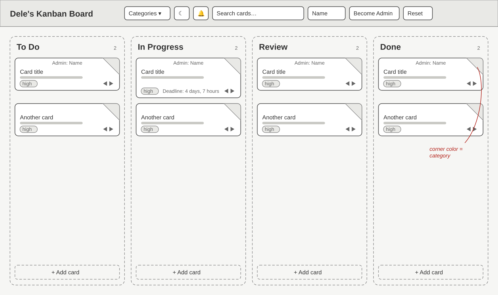
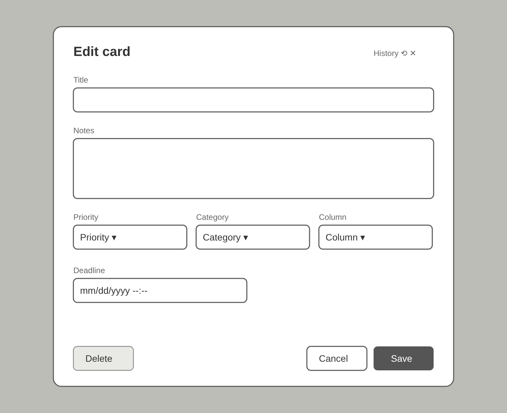
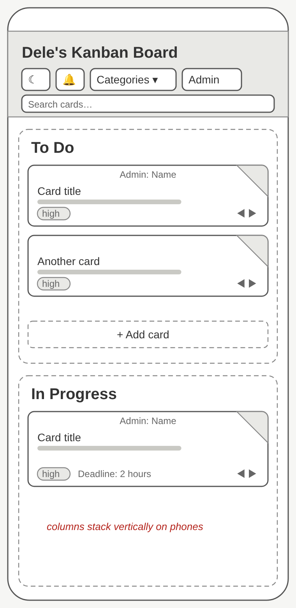
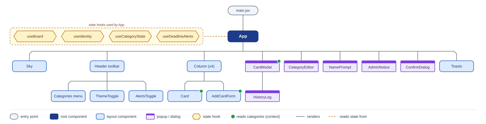

# Dele's Kanban Board 
[Link to deployed page](https://deles-kanban.netlify.app/)

A Kanban board for tracking work from idea to finished. Cards move through four columns (To Do, In Progress, Review, Done), each card is tagged with a category and an optional deadline, and every change is recorded in the card's history. It's built with React and Vite, needs no backend, and saves everything in the visitor's browser (localStorage).

The board doubles as a portfolio piece: anyone can move cards around, while adding, editing and deleting cards is reserved for the Admin role, so visitors can try out permissions without signing up.

## Features
- Add cards with a title, priority and category from the bottom of any column
- Each card has a corner gradient colored by category: Coding, Maintenance, Prototyping, Admin or Other
- Optional deadline on each card, shown as a live countdown ("Deadline: 4 days, 7 hours", or "Overdue by …")
- Admin and User roles: anyone can move cards; only admins can add, edit, delete, clear Done or reset. Switch with the "Become Admin" / "Become User" button (demo only)
- Each card shows who last moved it there, e.g. "Admin: Joe" or "User: Ashley". People are asked for a name the first time they change something, and it is kept until the tab closes
- Click a card to open it; admins can edit its title, notes, priority, category, deadline or column, or delete it. Everyone can open its History, a read-only log of who created, edited or moved it and when
- Drag and drop cards between columns and to reorder within a column
- Arrow buttons on each card to move it left/right (works on touch screens)
- Search across card titles and notes
- Rename categories and change their colors from the Categories menu (admins only; saved in your browser)
- Deadline alerts (bell button): an alert 15 minutes before a deadline and another when it passes, shown on the page and as a browser notification when the board isn't the window in focus. Alerts only fire while the board is open in a tab; notifying with the site closed would need push notifications from a server
- Clear all Done cards; Reset restores the sample board
- Light mode shows a sunny, lightly cloudy sky and dark mode a starry night; the moon/sun toggle fades between them and remembers your choice. Columns are see-through with a soft blur. Single-column layout on phones

## Wireframes

Low-fidelity layouts for the main screens. Sources are in `docs/wireframes/` as SVG.

**Board (desktop):** header toolbar on top, four columns left to right, and an "+ Add card" button at the bottom of each column.



**Card editor:** opens when a card is clicked. Admins can edit every field; users see it read-only and can open History.



**Phone:** the toolbar wraps and columns stack vertically.



## Component hierarchy



Each shape is a kind of part: blue boxes are layout components, purple windows are popups, and amber hexagons are the state hooks `App` reads. Solid lines show which component renders which, and the dashed line shows `App` reading state from the hooks before passing data down as props. A green dot marks components that read the category names and colors directly through `CategoriesContext`. The chart's source is `docs/component-hierarchy.svg`.

| File | What it does |
| --- | --- |
| `App.jsx` | top-level layout, header toolbar and all dialogs |
| `Column.jsx` | one column with its cards, drag-and-drop target and add form |
| `Card.jsx` | reusable card showing title, category corner, deadline and move arrows |
| `AddCardForm.jsx` | form at the bottom of a column for new cards |
| `CardModal.jsx` | edit or view a card; opens `HistoryLog` |
| `CategoryEditor.jsx` | change names and colors for categories |
| `useBoard.js` | board data, sample cards, saving and every card action |
| `identity.js` | session name and Admin/User role |
| `categories.js` | default categories plus saved edits |
| `alerts.js` | deadline reminder toasts and notifications |
| `deadline.js` | countdown text such as "4 days, 7 hours" |

## Data sample: a card

Each card is stored like this inside `localStorage["kanban-board:v1"]`. Columns hold an ordered list of card ids, and cards are kept in a lookup by id.

```json
{
  "id": "6f1c2a9e-3b4d-4e8a-9c71-2d5f0b8e4a13",
  "title": "Edit me",
  "description": "Click a card to edit its title, notes, priority, category and deadline.",
  "priority": "high",
  "category": "coding",
  "deadline": 1792368000000,
  "createdAt": 1791990000000,
  "placedBy": { "name": "Ashley", "role": "user" },
  "history": [
    { "action": "created", "detail": "in To Do", "name": "Dele", "role": "admin", "at": 1791990000000 },
    { "action": "edited", "detail": "deadline, priority", "name": "Dele", "role": "admin", "at": 1791993600000 },
    { "action": "moved", "detail": "from To Do to In Progress", "name": "Ashley", "role": "user", "at": 1792000800000 }
  ]
}
```

| Field | Meaning |
| --- | --- |
| `priority` | `low`, `medium` or `high` |
| `category` | `coding`, `maintenance`, `prototyping`, `admin` or `other` |
| `deadline` | due time as a JavaScript timestamp (milliseconds counted from midnight, January 1, 1970 UTC), or `null` for none |
| `placedBy` | who last added or moved the card into its column, shown at the top of the card |
| `history` | read-only log of created, edited and moved actions, oldest first |

The surrounding board looks like `{ "columns": [{ "id": "todo", "title": "To Do", "cardIds": ["6f1c…"] }, …], "cards": { "6f1c…": { …card… } } }`.

## Run locally
```bash
npm install
npm run dev      # http://localhost:5173
npm run build    # outputs to dist/
```

## Demo limits
Roles run entirely in the browser, so they show how permissions would work but don't secure anything. The board is saved in each visitor's own browser, so people don't see each other's changes. Sharing one board between people needs a backend and database.
